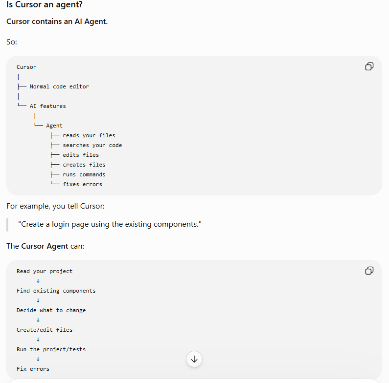

# AI
| Nm | #Question   |
| :---:   | :---: |
| 1   | [What is cursor. What is difference between cursor and AI sdk](#what-is-cursor)                                     |
| 2   | [Difference between Narrow AI, generative Ai, Agentic AI](#types-ai)                                     |
| 3   | [AI Model, local LLM, MCP Server](#ai-model-local-llm-mcp-server)                                     |
| 4   | [AI Shadowing](#ai-shadowing)                                     |

1. ### what-is-cursor

Cursor = a finished car 🚗
You can drive it immediately.
AI SDK = parts/tools to build your own car 🔧
You can build something specialized for yourself.

2. ### types-ai
Narrow AI - Ai for supporting some type of tasks, work.
Generative AI - AI that creates new task, content etc.
Agentic AI - Ai that can plan tasks, use tools etc.

3. ### ai-model-local-llm-mcp-server
Ai-model - is engine of AI tool.
LOCAL LLM - model running locally on your computer.
MCP (MODEL CONTEXT Protocol) - a way for a model or agent to access data

4. ### ai-shadowing
Using ai Tools, models, agents for work without required approval.
